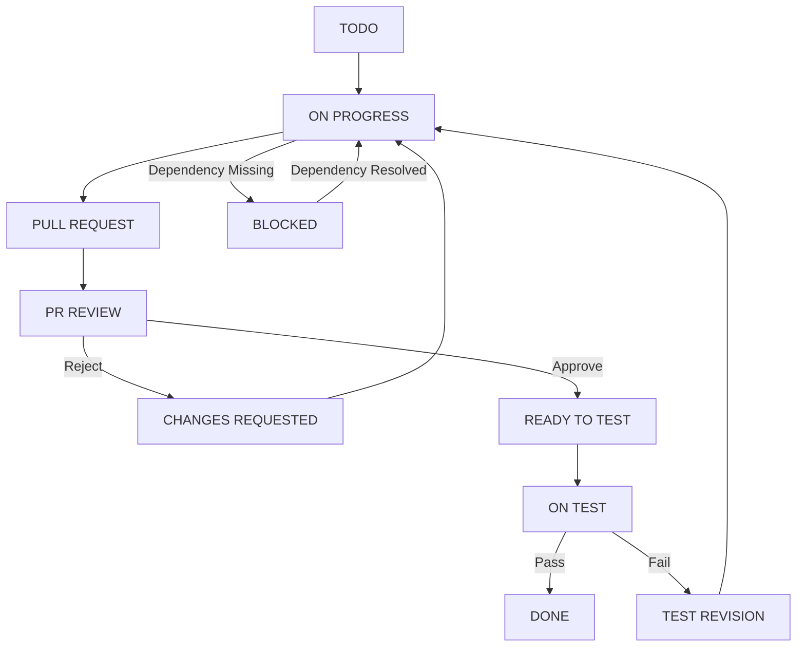

# AI Software Factory Workflow

## Overview

Workflow ini dirancang untuk:

- 1 Jira Story = 1 Branch = 1 Pull Request
- Backend Agent melakukan implementasi end-to-end
- Tech Lead Agent melakukan code review melalui PR
- QA melakukan validasi melalui environment testing
- Semua revisi menggunakan branch dan PR yang sama
- Tidak ada regenerate story dari awal saat revisi

---

# Jira Status Workflow

## Green Flow

```text
TODO
↓
ON PROGRESS
↓
PULL REQUEST
↓
PR REVIEW
↓
READY TO TEST
↓
ON TEST
↓
DONE
```

---

## Red Flow

### PR Rejected

```text
PR REVIEW
↓
CHANGES REQUESTED
↓
ON PROGRESS
↓
PULL REQUEST
↓
PR REVIEW
```

---

### QA Failed

```text
ON TEST
↓
TEST REVISION
↓
ON PROGRESS
↓
PULL REQUEST
↓
PR REVIEW
↓
READY TO TEST
↓
ON TEST
```

---

### Dependency Blocked

```text
ON PROGRESS
↓
BLOCKED
↓
ON PROGRESS
```

---

# Jira Columns

```text
TODO

ON PROGRESS

BLOCKED

PULL REQUEST

PR REVIEW

CHANGES REQUESTED

READY TO TEST

ON TEST

TEST REVISION

DONE
```

---

# Branch Strategy

## Epic Branch

Created by Tech Lead.

Example:

```text
feature/CRM-100
```

---

## Story Branch

Created by Backend Agent.

Example:

```text
feature/CRM-123
```

---

## Relationship

```text
Epic
└── feature/CRM-100

Story
├── feature/CRM-123
├── feature/CRM-124
├── feature/CRM-125
```

---

# Pull Request Strategy

```text
feature/CRM-123
↓
feature/CRM-100
```

Rules:

```text
1 Story = 1 PR

1 Story = 1 Branch

PR tetap digunakan sampai status DONE
```

---

# Backend Agent Responsibilities

## Trigger

Status:

```text
TODO
```

---

## Actions

### Move Jira

```text
TODO
↓
ON PROGRESS
```

---

### Create Branch

```text
feature/{JIRA-ID}
```

Example:

```text
feature/CRM-123
```

---

### Implement Story

Generate:

```text
Migration

Models

DTO

Repository

Service

Handler

Swagger

Unit Test
```

---

### Self Validation

Must pass:

```bash
go fmt ./...

go vet ./...

golangci-lint run

go test ./...

go build ./...
```

Additional validation:

```text
Swagger Validation

Architecture Validation

Migration Validation

Story Validation
```

---

### Self Fix Loop

If validation fails:

```text
Fix
↓
Run Validation Again
↓
Repeat Until Pass
```

---

### Create Pull Request

```text
feature/CRM-123
↓
feature/CRM-100
```

---

### Move Jira

```text
ON PROGRESS
↓
PULL REQUEST
```

---

# Tech Lead Agent Responsibilities

## Trigger

Status:

```text
PULL REQUEST
```

---

## Move Jira

```text
PULL REQUEST
↓
PR REVIEW
```

---

## Review Scope

Review:

```text
Story Compliance

Technical Design Compliance

Architecture

DDD Boundaries

Security

Performance

Naming Convention

Code Quality
```

---

## If Rejected

Move Jira:

```text
PR REVIEW
↓
CHANGES REQUESTED
```

Provide:

```text
Review Findings

Required Changes

Architecture Notes
```

---

## If Approved

Approve PR.

Move Jira:

```text
PR REVIEW
↓
READY TO TEST
```

---

# QA Responsibilities

## Trigger

Status:

```text
READY TO TEST
```

---

## Move Jira

```text
READY TO TEST
↓
ON TEST
```

---

## Validation Scope

```text
Acceptance Criteria

Business Rules

Functional Testing

Regression Testing

API Validation

UI Validation
```

---

## If Passed

Move Jira:

```text
ON TEST
↓
DONE
```

---

## If Failed

Move Jira:

```text
ON TEST
↓
TEST REVISION
```

Provide:

```text
Expected Result

Actual Result

Steps To Reproduce

Evidence

Severity
```

Example:

```text
Expected:
Address Line 2 is saved

Actual:
Address Line 2 is empty

Steps:
1. Open Create Customer
2. Fill Address Line 2
3. Save
4. Open Detail Screen

Severity:
Medium
```

---

# Revision Workflow

## CHANGES REQUESTED

Backend Agent must:

```text
Read PR Comments

Find Existing PR

Checkout Existing Branch

Fix Review Findings

Push Same Branch
```

Move Jira:

```text
CHANGES REQUESTED
↓
ON PROGRESS
```

---

## TEST REVISION

Backend Agent must:

```text
Read QA Findings

Find Existing PR

Checkout Existing Branch

Fix QA Findings

Push Same Branch
```

Move Jira:

```text
TEST REVISION
↓
ON PROGRESS
```

---

# Critical Rules

## New Branch Creation

Allowed only when:

```text
TODO
↓
ON PROGRESS
```

---

## Revisions

When status is:

```text
CHANGES REQUESTED
```

or

```text
TEST REVISION
```

Agent MUST:

```text
Reuse Existing Branch

Reuse Existing Pull Request
```

Agent MUST NOT:

```text
Create New Branch

Create New Pull Request

Regenerate Story From Scratch
```

---

# Dependency Management

## Before Starting

Backend Agent must check:

```text
Story Dependency

Epic Dependency

Technical Dependency
```

---

## Dependency Not Ready

Move Jira:

```text
ON PROGRESS
↓
BLOCKED
```

Store reason:

```text
Blocked By Story

Blocked By Epic

Blocked By Environment

Blocked By External Team
```

---

## Dependency Resolved

Move Jira:

```text
BLOCKED
↓
ON PROGRESS
```

---

# Required Jira Metadata

Every story must maintain:

```text
Jira ID

Epic ID

Branch Name

Pull Request URL

Pull Request Number

Review Iteration

QA Iteration

Current Status

Last Feedback Source
```

---

# Mermaid Diagram



# Golden Rules

```text
1 Story = 1 Branch

1 Story = 1 Pull Request

Backend Agent owns implementation

Tech Lead Agent owns PR review

QA owns testing

All revisions use the same branch

All revisions use the same pull request

Never regenerate an existing story during revisions
```